# AudioTastic user guide

AudioTastic is a desktop music player in the classic style: a compact main window with a playlist, an equalizer and an Art & Lyrics window that snap to it and move with it. It plays almost every audio format, mixes tracks like a DJ, casts to TVs and speakers, and can be extended with plugins and skins.

This guide describes AudioTastic 0.10. Screenshots use the default skin at its default size.

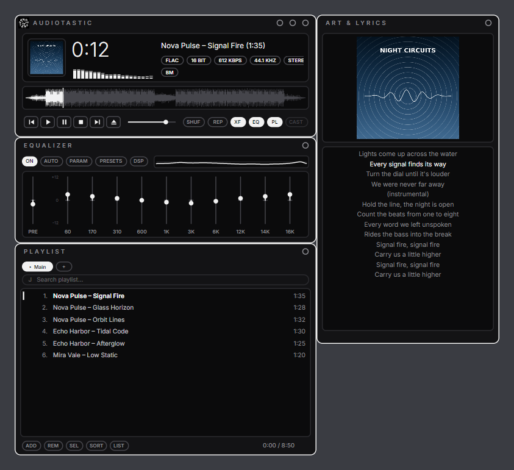

## Contents

1. [Getting started](#getting-started)
2. [The main window](#the-main-window)
3. [Playlists](#playlists)
4. [Playback](#playback)
5. [DJ-style crossfading](#dj-style-crossfading)
6. [Equalizer, effects and VST3](#equalizer-effects-and-vst3)
7. [Tags, album art and lyrics](#tags-album-art-and-lyrics)
8. [Casting to TVs and speakers](#casting-to-tvs-and-speakers)
9. [Converting files](#converting-files)
10. [Keyboard and screen readers](#keyboard-and-screen-readers)
11. [Windows integration](#windows-integration)
12. [Command line](#command-line)
13. [Skins and plugins](#skins-and-plugins)
14. [Settings, backup and your data](#settings-backup-and-your-data)
15. [Troubleshooting](#troubleshooting)

## Getting started

- **Windows:** run the setup (`AudioTastic-<version>-win-x64-setup.exe`). It installs for your user only, needs no administrator rights, and adds a Start menu entry. The `-portable.zip` instead runs from any folder or USB stick and keeps everything next to the program. Windows builds are not code-signed yet, so Windows may show a SmartScreen warning the first time.
- **macOS:** open the `.dmg` and drag AudioTastic to Applications. **Linux:** make the `.AppImage` executable and run it.

On the first start in Windows, AudioTastic asks whether to use it for audio files. **Yes, set up** registers it and opens *Settings › Default apps*, where you make it the default player.

To play music, drop files or folders on the player, press **L** to open files, or use *Main menu › Open folder…*. Internet radio: *Open URL…* (**Ctrl+L**) with a stream address or an `.m3u` / `.pls` link.

## The main window

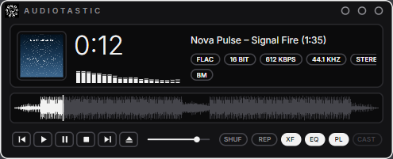

| Area | What it does |
|---|---|
| Logo (top left) | The main menu (also **Alt+F**, or right-click anywhere on the player). |
| Album art | The cover of the playing track; click it for the Art & Lyrics window. |
| Time | Elapsed time; click to show the time remaining. It blinks while paused. |
| Visualisation | Spectrum analyser or oscilloscope; click to switch (spectrum, oscilloscope, off). |
| Title | Scrolls when it is too long. The badges show the format, bit depth, bit rate, sample rate and channels; a second row shows states such as the output mode, speed, A-B repeat, stop after current and the sleep timer. Double-click them for the file's details. |
| Waveform | The whole track; click or drag to seek. The played part is filled, a planned crossfade is shaded, A-B markers can be dragged. |
| Buttons | Previous, play, pause, stop, next, open files, volume (also the mouse wheel; right-click for the output device), and the toggles SHUF (shuffle), REP (repeat off, playlist or track), XF (crossfading), EQ, PL (playlist) and CAST. |

**Mini player:** **Ctrl+W** (or double-click the title bar) shrinks the player to two compact rows; the same key brings the full player back.

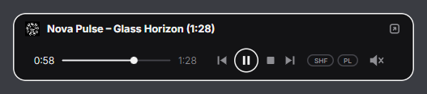

**Size:** *Settings › Interface › Player size* (100–200 %, 150 % by default), and **Ctrl+D** doubles it. Windows snap to each other and to the screen edges within 10 pixels and move together with the main window.

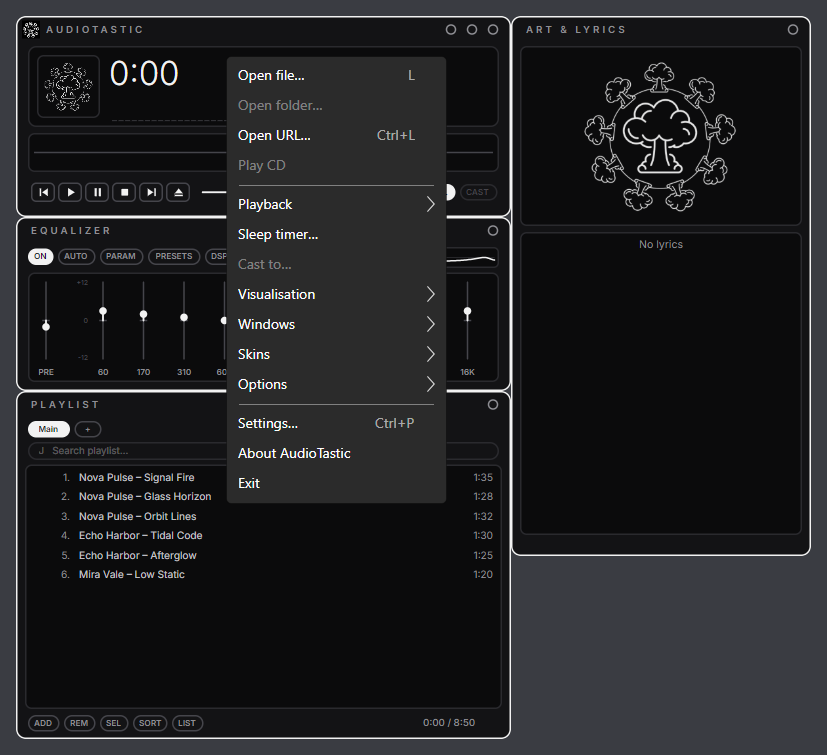

## Playlists

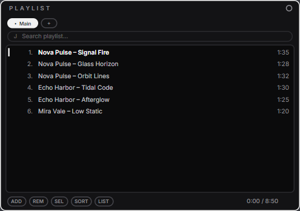

- **Tabs:** several playlists side by side; **+** makes a new one, double-click a tab to rename it, right-click it to save, duplicate, move or close it. The playing playlist is marked ▸.
- **Adding:** drag files and folders in (drop between rows to insert there), use the ADD button, or open files with **L**. Drag rows to reorder them; hold **Ctrl** when dropping on another tab to move instead of copy.
- **Search:** press **J** and type: the list filters as you type; **Enter** plays the first match, **Shift+Enter** queues it.
- **Sort and tidy:** SORT sorts by title, artist, album, track number, path, file name or duration (the selection only, when several rows are selected), and reverses or shuffles the list; REM removes the selection, duplicates or missing files. **Ctrl+Z** undoes.
- **Formats:** M3U, M3U8, PLS, XSPF, WPL and CUE, read and written (LIST › Save playlist…). A single-file album with a `.cue` sheet (also embedded in FLAC or APE tags) shows as separate tracks.
- **Queue:** **Q** queues the selected tracks to play next; their position shows as `[1]`, `[2]`…
- **Totals:** the bottom line shows the length of the selection and of the whole list.

Playlists are saved automatically and come back the next time you start AudioTastic, with the track and position you were at (*Settings › Playback › Resume*).

## Playback

- **Formats:** WAV, FLAC, MP3, AIFF, APE, AAC/M4A, ALAC, WavPack, Ogg Vorbis, Opus, WMA, Musepack, TTA, Shorten, DSD (DSF/DFF), tracker modules (MOD, XM, IT, S3M), MIDI (with a SoundFont the MIDI plugin downloads on request, or your own), OptimFROG (with the separate OptimFROG plugin) and internet radio.
- **Gapless playback** joins tracks without a gap. **Short fades** on pause, stop and seek avoid clicks (*Settings › Playback*).
- **ReplayGain** evens out loudness from the tags, or from AudioTastic's own loudness analysis (*Settings › Playback › ReplayGain*; off by default).
- **Speed** 0.5–2.0×, with or without keeping the pitch (*Main menu › Playback › Speed…*).
- **A-B repeat:** **[** sets A, again sets B, again clears.
- **Stop after current:** **Shift+V**. **Sleep timer:** *Main menu › Sleep timer…* (also in the tray menu).
- **Output:** *Settings › Output* chooses the device, exclusive (bit-perfect) mode where the system allows it, bit depth and resampling. DSD can be sent as DoP to a DAC that supports it.

## DJ-style crossfading

Switch it on with the **XF** button and choose the mode in *Settings › Crossfading*.

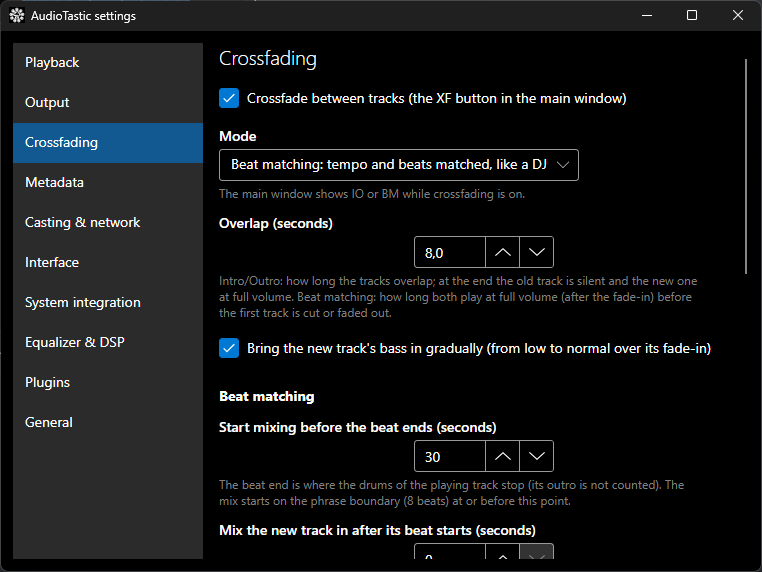

- **Intro/Outro:** the playing track fades out while the next one fades in, over the overlap you set.
- **Beat matching:** the next track's tempo is changed to match the playing one (without changing its pitch), its beats are lined up with the playing track's, and both play together at full volume for the overlap; then the first track stops or fades out. The new track fades in with its bass held back at first, like a DJ mix. Afterwards the new track returns to its own tempo, at the next break or gradually. When the tempos are too far apart (*tempo limit*, ±8 % by default), that transition uses Intro/Outro instead.

AudioTastic analyses each track's tempo, beats and breaks once in the background and remembers the result. If a mix sounds off for one track, right-click it in the playlist › *Adjust beat grid…* moves its beats a few milliseconds.

## Equalizer, effects and VST3

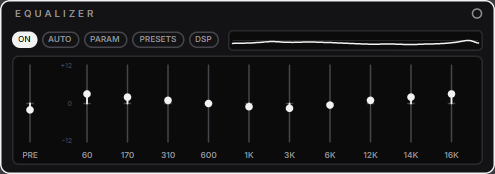

- **Equalizer:** ten bands and a preamp (**Alt+G** shows the window, **ON** switches it). Drag a slider, use the mouse wheel or, with the keyboard, the arrow keys (half a decibel; Page Up/Down 3 dB; Home resets the band).
- **Presets:** built-in and your own, plus Winamp `.eqf` import (PRESETS). **AUTO** loads the preset assigned to the file or its genre.
- **Parametric mode** (PARAM): up to ten bands with your own frequency, gain and Q.
- **DSP chain** (DSP button): compressor, limiter, reverb and stereo widening, in the order you set; tick an effect to switch it on.
- **VST3 effects:** *DSP chain › Add VST3 effect…* lists the effects installed on your computer (the standard VST3 folders, plus any you add in *Settings › Equalizer & DSP*). Select one in the chain and press *Open editor* for its own window. Its settings are saved with the chain. A plug-in that crashes while being scanned is set aside instead of taking the player down; *Rescan all* tries it again. The time display allows for effects that delay the sound (look-ahead), so it matches what you hear.

## Tags, album art and lyrics

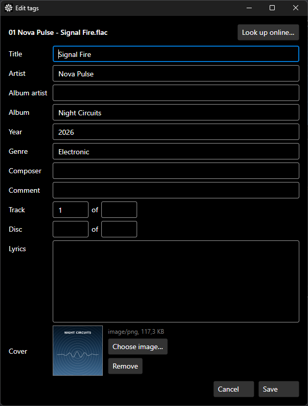

- **Edit tags:** select tracks › **Ctrl+E**. Edit one file or several at once (fields that differ show "multiple"); add or remove the cover. A file that is playing is written when the player lets go of it.
- **Look up online:** in the tag editor or the playlist menu. AudioTastic searches MusicBrainz and shows each match next to your current tags, with a tick per field to use; the Cover Art Archive supplies covers. With your own free **Discogs** token (discogs.com › Settings › Developers; paste it in *Settings › Metadata* and switch Discogs on), Discogs is asked first for the album, year, genre, track and disc numbers and the cover, and MusicBrainz only when Discogs has nothing. Nothing is written until you save.
- **Album art** is the file's own cover, or a `cover`, `folder` or `front` picture in the same folder.
- **Lyrics:** a `.lrc` file next to the track (synced, highlighted as the song plays; click a line to jump there) or lyrics in the tags. **Alt+L** shows the Art & Lyrics window.
- **File info:** **Alt+3** shows the format, bit rate, sample rate, bit depth, channels, codec, size, loudness, tempo and all tags.

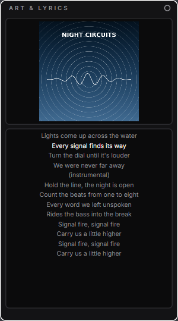 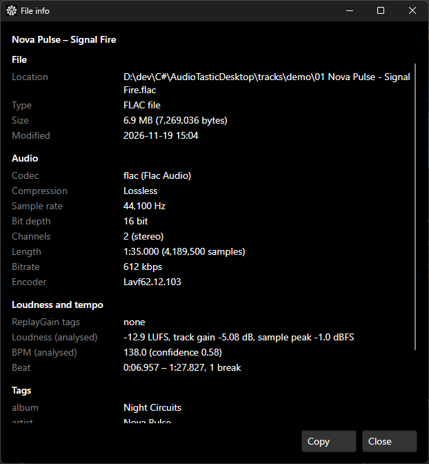

## Casting to TVs and speakers

The **CAST** button (or *Main menu › Cast to…*) lists the Chromecasts and DLNA devices (smart TVs, network receivers) on your network.

- **Audio:** the playing track moves to the device at the same position; play, pause, seek, next and volume control it. Files a device cannot play are converted on the fly. *This computer* brings playback back.
- **Audio and video** (devices with a screen): the player's own mix, crossfades and equalizer included, goes to the TV together with the visualisation. The volume slider sets the TV's volume.
- **Visuals only** (devices with a screen): the visualisation is shown on the TV while the music keeps playing on the computer. A TV shows the picture about two seconds late, so AudioTastic draws it that far ahead. To fine-tune a TV, open *CAST › the TV › Picture delay…*: the TV flashes white on every kick while it is open.

Choose the visualisation, resolution and frame rate in *Settings › Casting & network*. AudioTastic serves the audio from a small built-in web server that answers only devices on your local network; Windows may ask to allow it through the firewall. AirPlay is not supported yet.

## Converting files

Select tracks in the playlist › right-click › **Convert…**

- **Formats:** FLAC, Apple Lossless, WAV, MP3 (constant or variable bit rate), AAC, Opus and Ogg Vorbis, with the quality for each.
- **Where:** a folder (your Music folder by default) or next to the originals, with a name pattern such as `%albumartist%/%album%/%track% - %title%` (fields: `%artist%`, `%albumartist%`, `%album%`, `%title%`, `%track%`, `%disc%`, `%year%`, `%genre%`, `%filename%`; `/` makes subfolders). An example shows what the first file will be called.
- Tags and the cover come along; CUE tracks become separate files. A file that already exists is skipped, replaced or numbered, as you choose; the original is never overwritten. Several files are converted at once, and **Stop** removes unfinished files.

## Keyboard and screen readers

Every control in the player, playlist and equalizer can be reached with **Tab**; a thin outline shows where you are. **Enter** or **Space** presses the outlined button; the arrow keys move sliders (volume, position, equalizer bands); **Alt+F** or the context-menu key opens the main menu. Screen readers (Narrator on Windows) read each control's name, state, value and shortcut key, read playlist rows as "3. Artist – Title, 5:59", and announce a new track.

| Keys | Action |
|---|---|
| Z / X / C / V / B | Previous / Play / Pause / Stop / Next |
| L · Ctrl+L | Open files · Open URL |
| S · R | Shuffle · Repeat |
| J · Q | Search the playlist · Play next (queue) |
| Shift+V · [ | Stop after current · A-B repeat |
| Up / Down · Left / Right | Volume · Seek 5 seconds |
| Alt+G · Alt+E · Alt+L | Equalizer · Playlist · Art & Lyrics windows |
| Ctrl+W · Ctrl+D | Mini player · Double size |
| Ctrl+E · Alt+3 · Ctrl+P | Edit tags · File info · Settings |
| Alt+F | Main menu |

## Windows integration

- **Media controls:** AudioTastic shows in Windows' media flyout and lock screen with the title and cover; keyboard media keys and headset buttons control it.
- **Global hotkeys** work while another program is in front: Ctrl+Alt+Home play/pause, Ctrl+Alt+End stop, Ctrl+Alt+PgUp/PgDn previous/next, Ctrl+Alt+Up/Down volume. Change or switch them off in *Settings › System integration*.
- **Taskbar:** previous, play/pause and next buttons under the preview, and the playing position on the taskbar button.
- **Tray icon:** click to hide or show the player, right-click for the controls and the sleep timer. Optional minimise and close to the tray.
- **Explorer:** *Open in AudioTastic* and *Enqueue in AudioTastic* on audio files and playlists (on Windows 11 under *Show more options*). Files opened while AudioTastic runs go to the running player.
- **Notifications** on track changes (off by default; *Settings › Interface*).

## Command line

```
AudioTastic [files…] [--open | --enqueue] [--play] [--pause] [--playpause] [--stop] [--next] [--prev]
            [--volume 0-100] [--seek seconds] [--quit] [--portable] [--help] [--version]
```

Commands go to the running player (and start it when needed; `--stop`, `--pause` and `--quit` do nothing when no player runs). On Windows they can also be written `/next`, `/volume 40`.

## Skins and plugins

- **Skins** change the look of every player window. Install an `.atskin` file with *Main menu › Skins › Install skin…*; skin authors find the format in [docs/skins/skin-format.md](../skins/skin-format.md).
- **Plugins** add formats, effects, visualisations, output devices and panels. *Settings › Plugins* installs `.atplugin` files, switches plugins on and off, and opens their settings. A plugin that keeps failing is switched off for the session instead of stopping the player. Plugin authors: [docs/plugins/plugin-guide.md](../plugins/plugin-guide.md).

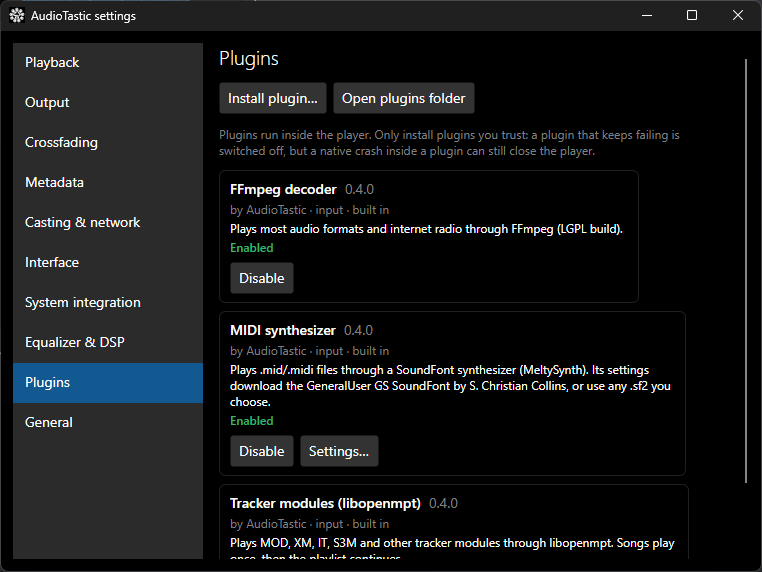

## Settings, backup and your data

*Settings* (**Ctrl+P**) has ten groups: Playback, Output, Crossfading, Metadata, Casting & network, Interface, System integration, Equalizer & DSP, Plugins and General. Changes apply at once.

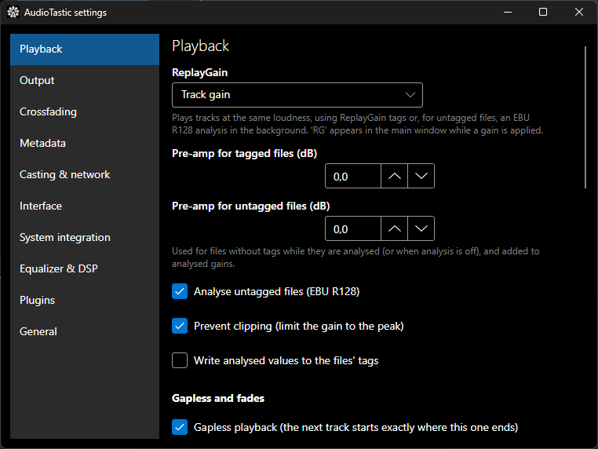

**Backup:** *Settings › General › Export settings…* writes your settings, playlists, equalizer presets, DSP chain, hotkeys and installed skins to one `.atbackup` file. *Import settings…* shows what a backup holds and lets you choose per group; AudioTastic then restarts to apply it, after saving what it replaces to the `backups` folder. Your Discogs token is never put in a backup.

**Where your data is:** `%APPDATA%\AudioTastic` (Windows), `~/Library/Application Support/AudioTastic` (macOS), `~/.config/AudioTastic` (Linux): settings, playlists, presets, skins, plugins, the analysis cache, logs and crash reports. *Settings › General › Open data folder* takes you there. In **portable mode** (a file named `portable` next to the program, as in the portable zip, or `--portable`) everything is kept in a `Data` folder next to the program.

**Privacy:** AudioTastic sends nothing anywhere on its own. Online lookups happen only when you ask for one (title, artist and length go to MusicBrainz or, with your token, Discogs); casting talks only to devices on your local network.

## Troubleshooting

- **Logs:** `logs` in the data folder (kept for 7 days); *Settings › General › Log level* makes them more detailed.
- **Crashes:** a crash report is written to `crash` in the data folder, and the next start offers to open it. Nothing is uploaded.
- **A file will not play:** *File info* (Alt+3) shows what AudioTastic read from it; damaged files are skipped with a message.
- **The device disappeared:** if no audio device is left (for example when a Remote Desktop session ends), AudioTastic pauses and continues by itself when a device is back.
- **No sound:** check the device in *Settings › Output* (right-click the volume slider for a quick choice); with exclusive mode on, another program may hold the device.
- **A cast device is missing:** the computer and the device must be on the same network, and the firewall must allow AudioTastic.
