# AudioTastic User Manual

AudioTastic is a desktop music player in the classic style: a compact main window, with a playlist, an equalizer and an Art & Lyrics window that snap to it and move with it. It plays almost every audio format, mixes one track into the next like a DJ, casts to TVs and speakers, and can be extended with plugins and skins.

This manual describes **AudioTastic 0.10** on Windows. macOS and Linux work the same way, except for the parts marked *Windows only*. The screenshots show the default skin at its default size, with demo tracks. A PDF version of this manual comes with the Windows installer (Start menu › *AudioTastic User Manual*).

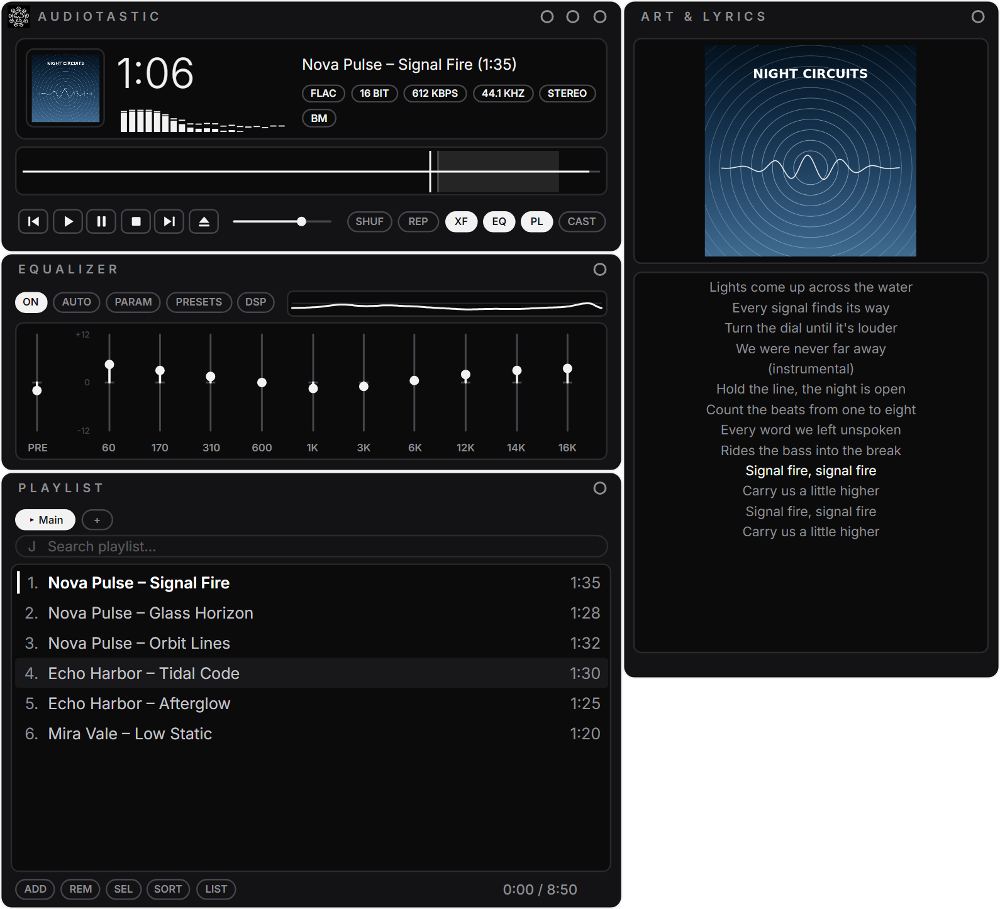

## Contents

1. [Installing and starting](#installing-and-starting)
2. [The player at a glance](#the-player-at-a-glance)
3. [The main window](#the-main-window)
4. [Playing music](#playing-music)
5. [Playlists](#playlists)
6. [Playback options](#playback-options)
7. [DJ-style crossfading](#dj-style-crossfading)
8. [Equalizer and effects](#equalizer-and-effects)
9. [Album art, lyrics and tags](#album-art-lyrics-and-tags)
10. [Casting to TVs and speakers](#casting-to-tvs-and-speakers)
11. [Converting files](#converting-files)
12. [Windows integration](#windows-integration)
13. [Keyboard and screen readers](#keyboard-and-screen-readers)
14. [Command line](#command-line)
15. [Skins and plugins](#skins-and-plugins)
16. [Settings](#settings)
17. [Backup and your data](#backup-and-your-data)
18. [Troubleshooting](#troubleshooting)
19. [Supported formats](#supported-formats)

## Installing and starting

Download AudioTastic from the [Releases page](https://github.com/castenskiold/AudioTasticDesktop/releases). Each release lists the SHA-256 checksum of every file in `SHA256SUMS.txt`.

**Windows.** Run `AudioTastic-<version>-win-x64-setup.exe` (or `-win-arm64-setup.exe` on an ARM PC). The setup installs AudioTastic for your user only, into `%LOCALAPPDATA%\Programs\AudioTastic`, and needs no administrator rights. It adds Start menu entries for AudioTastic and this manual, and an entry in *Settings › Apps*. AudioTastic is not code-signed yet, so Windows SmartScreen may say the publisher is unknown: choose *More info › Run anyway*.

- **Portable edition:** unpack `AudioTastic-<version>-win-x64-portable.zip` into any folder, for example on a USB stick, and run `AudioTastic.exe`. Settings, playlists and caches are kept in a `Data` folder next to the program, and nothing is registered with Windows unless you switch it on.
- **Uninstalling:** *Settings › Apps › Installed apps › AudioTastic › Uninstall*. This removes the program, its Start menu entries, file types and Explorer entries. Your settings and playlists stay in your data folder (see [Backup and your data](#backup-and-your-data)).

**macOS.** Open the `.dmg` and drag AudioTastic to Applications. The app is not signed or notarized yet: allow it once in *System Settings › Privacy & Security*, or run `xattr -dr com.apple.quarantine /Applications/AudioTastic.app` in Terminal.

**Linux.** Make the `.AppImage` executable (`chmod +x AudioTastic-*.AppImage`) and run it. AudioTastic needs a desktop with X11 or XWayland.

**The first start (Windows).** AudioTastic asks whether to use it for audio files. *Yes, set up* registers it for every audio and playlist type it plays and opens Windows *Settings › Default apps*, where you choose it as the default. You can do this later in *Settings › System integration*. Only one AudioTastic runs at a time: files you open while it runs go to the running player, which adds them to the playlist and plays them (or, if you choose, replaces the playlist with them).

## The player at a glance

AudioTastic has four player windows:

| Window | Show or hide | What it is for |
|---|---|---|
| Main window | always shown (or the mini player) | Playback, the time, the waveform, the visualization and the buttons. |
| Playlist | **Alt+E**, or the **PL** button | Your playlists, in tabs. |
| Equalizer | **Alt+G**, or the **EQ** button | The 10-band and parametric equalizer, presets and the effects chain. |
| Art & Lyrics | **Alt+L**, or click the cover in the main window | The album cover and the lyrics. |

The windows **snap** to each other and to the screen edges when they come within 10 pixels, and windows docked to the main window move with it. Drag a window by its title strip. The playlist and Art & Lyrics windows can be resized from their bottom-right corner, and their edges snap too. AudioTastic remembers where every window was.

**Size.** The player is drawn at 150 % of the skin's size. Change it in *Settings › Interface › Player size* (100–200 %), or press **Ctrl+D** for double size.

**The main menu** opens from the logo at the top left of the main window, by right-clicking anywhere on the player, or with **Alt+F**. It holds everything that has no button of its own.

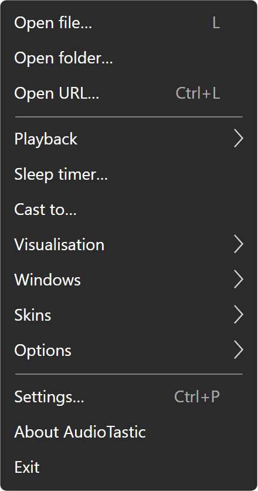

| Item | What it does |
|---|---|
| Open file… · Open folder… · Open URL… | Add files, a folder or an internet radio address to the playlist and play them. |
| Playback › | Shuffle, Repeat (off, playlist, track), Speed…, A-B repeat, Stop after current, Clear queue. |
| Sleep timer… | Stop or fade out after a time, at the end of the track or of the playlist. |
| Cast to… | Send the music or the visualization to a TV or network speaker. |
| Visualisation › | Spectrum, oscilloscope or off; visualization plugins. |
| Windows › | Show or hide the equalizer, playlist, Art & Lyrics, mini player and plugin panels. |
| Skins › | Choose, install or open the folder of skins. |
| Options › | Double size, Always on top. |
| Settings… · About AudioTastic · Exit | |

## The main window

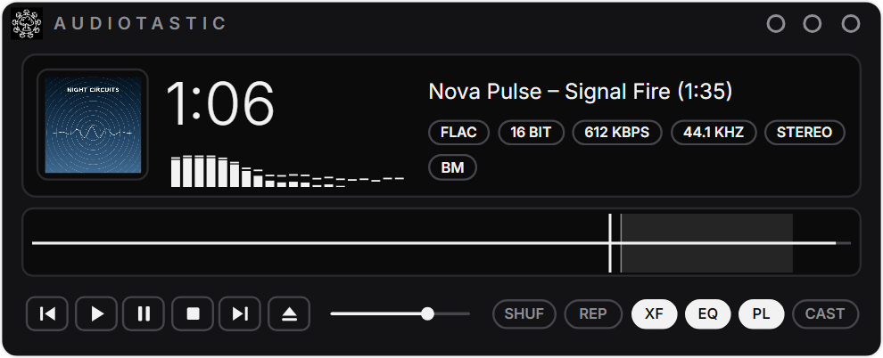

| Part | What it does |
|---|---|
| Logo (top left) | Opens the main menu. |
| ○ ○ ○ (top right) | Mini player, minimize, close. |
| Cover | The cover of the playing track. Click it for the Art & Lyrics window. |
| Time | The elapsed time. Click it to show the time remaining instead. It blinks while playback is paused. |
| Visualization | A spectrum analyzer or an oscilloscope. Click it to switch between spectrum, oscilloscope and off. |
| Title | Artist, title and length. It scrolls when it is too long (*Settings › Interface*). |
| Badges, first row | The file: format, bit depth, bit rate, sample rate and channels. Double-click a badge for the file's details. |
| Badges, second row | What is active: **IO** or **BM** (crossfading mode), **RG** (ReplayGain), **OUT** (the device runs at another rate than the file), the speed, **A-B**, **STOP AFTER** and **SLEEP**. |
| Waveform | The whole track. The played part is bright. Click or drag to seek. A shaded area shows where the next crossfade will happen; A-B repeat markers can be dragged. Internet radio shows a scrolling live waveform. |
| Buttons | Previous, Play, Pause, Stop, Next, and Open (⏏). |
| Volume | Drag, click, use the mouse wheel or the Up and Down keys. **Right-click** it to choose the output device. |
| SHUF · REP | Shuffle on or off; Repeat off, playlist or track. |
| XF · EQ · PL · CAST | Crossfading on or off; show the equalizer; show the playlist; casting. |

### Mini player

**Ctrl+W**, or double-click the main window's title strip, shrinks the player to two rows. The same key, or the expand button at its top right, brings the full player back with its docked windows.

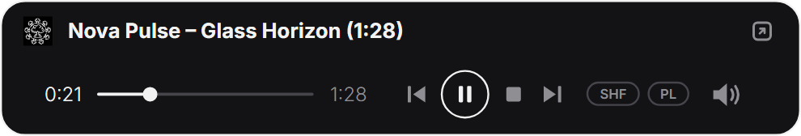

The top row shows the logo (the main menu) and the title. The bottom row has the elapsed time, a seek bar, the length, Previous, Play/Pause, Stop and Next, the **SHF** and **PL** toggles, and a speaker: click it to mute, and use the mouse wheel on it for the volume. Choose whether the mini player stays on top of other windows in *Main menu › Options › Always on top* while it is shown, or in *Settings › Interface*.

## Playing music

- **Drop** files or folders on the main window or the mini player to add them to the playlist and play them. Dropping on the playlist window adds them where you drop.
- **Open file…** (**L**), **Open folder…** and **Open URL…** (**Ctrl+L**) are in the main menu. Open file… also has a button (⏏) in the main window.
- **Transport keys:** **Z** previous, **X** play, **C** pause, **V** stop, **B** next. **Left** and **Right** seek 5 seconds; **Up** and **Down** change the volume.
- **Double-click** a track in the playlist, or select it and press **Enter**, to play it.
- **Shuffle** (**S**) plays the playlist in random order; **Repeat** (**R**) switches between off, the whole playlist and the current track.

**Internet radio.** *Open URL…* takes a stream address (`http://` or `https://`) or a link to an `.m3u`, `.pls` or `.xspf` playlist. The station's current song appears as the title. If the connection drops, AudioTastic reconnects by itself (up to five times). Streams show a broadcast icon in the playlist.

## Playlists

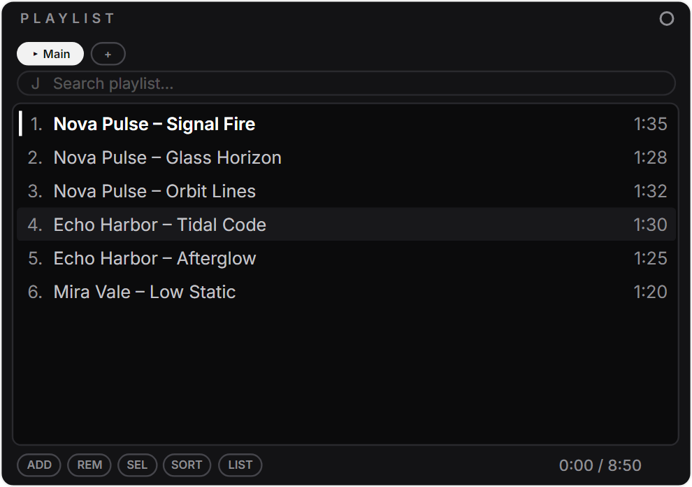

**Tabs.** Keep several playlists side by side. **+** makes a new one. Double-click a tab to rename it. Right-click a tab to rename, duplicate, save, move or close it. The tab of the playlist that is playing is marked ▸.

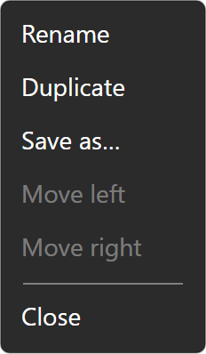

**The rows** show the track number, artist, title and length. The playing track is bright with a bar on the left. `[1]`, `[2]`… mark tracks in the play-next queue, and `»` marks a long file that will continue where you left it. The bottom line shows the length of the selection and of the whole playlist, and *Analysing n/m* while AudioTastic analyzes tracks in the background.

**Selecting and moving.** Click, Shift+click and Ctrl+click select tracks; **Ctrl+A** selects all. Drag tracks to move them, or press **Alt+Up** and **Alt+Down**. Drop tracks on another tab to copy them there, or hold **Ctrl** to move them. **Delete** removes the selection. **Ctrl+Z** undoes and **Ctrl+Y** redoes any change to the list.

**The buttons at the bottom** each open a menu:

| ADD | REM | SEL |
|---|---|---|
| 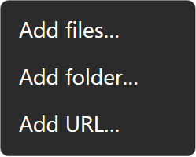 | 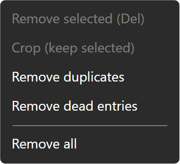 | 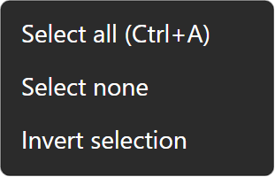 |
| Add files, a folder (with its subfolders) or an internet radio address. | Remove the selection, keep only the selection, remove duplicates or tracks whose files are gone, or empty the list. | Select all, none, or invert the selection. |

| SORT | LIST |
|---|---|
| 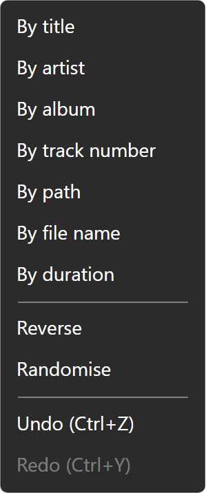 | 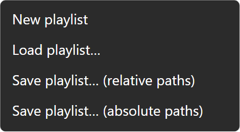 |
| Sort by title, artist, album, track number, path, file name or length; reverse or shuffle the order. With several tracks selected, only the selection is sorted. | New playlist, load a playlist file, or save this one with paths relative to the playlist file (best for a music folder you move around) or absolute. |

**Search.** Press **J** and type: the list shows only the tracks that match, as you type. **Enter** plays the first match, **Shift+Enter** puts it in the queue, and **Esc** clears the search.

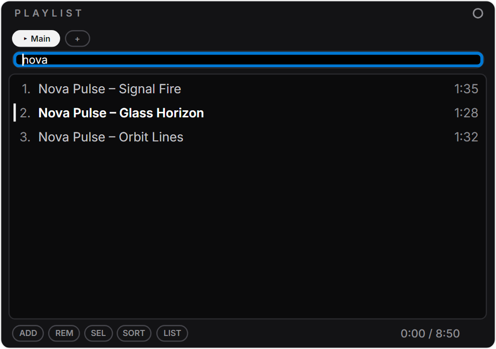

**The track menu.** Right-click a track:

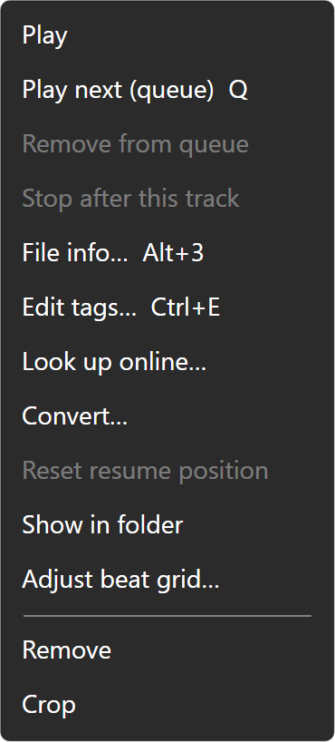

- **Play next (queue)** (**Q**) puts the selected tracks in the play-next queue, which plays before the rest of the playlist. *Remove from queue* takes them out again; *Main menu › Playback › Clear queue* empties it.
- **Stop after this track** (**Shift+V** for the playing track) stops playback when the track ends.
- **File info…**, **Edit tags…**, **Look up online…** and **Convert…** are described in [Album art, lyrics and tags](#album-art-lyrics-and-tags) and [Converting files](#converting-files).
- **Reset resume position** makes a long file start from the beginning again.
- **Show in folder** opens the file's folder.
- **Adjust beat grid…** moves the track's beats a few milliseconds if a beat-matched mix sounds off (see [DJ-style crossfading](#dj-style-crossfading)).

**Playlist files.** AudioTastic reads and writes M3U, M3U8, PLS, XSPF and WPL playlists, and reads CUE sheets. A single-file album with a `.cue` sheet, or with a cue sheet inside its FLAC or APE tags, appears as separate tracks with their own titles and lengths. Your playlists are saved automatically and come back the next time you start AudioTastic.

## Playback options

**Gapless playback.** Tracks follow each other without a gap, as on the album (*Settings › Playback*).

**Fades.** Pause, stop and seeking fade the sound out and in over a fraction of a second, so there are no clicks. Each fade can be switched off or lengthened in *Settings › Playback*.

**ReplayGain** plays every track at the same loudness. It uses the ReplayGain tags in your files and analyzes files without tags in the background (EBU R128). Choose *Track gain*, *Album gain* (keeps the loudness differences within an album) or *Auto* in *Settings › Playback*. It is off by default. **RG** shows in the main window while a gain is applied.

**Speed.** *Main menu › Playback › Speed…* plays from 0.5× to 2.0×, with or without keeping the pitch. At 1.0× the sound is untouched. The speed can be remembered per file (*Settings › Playback*), which suits audiobooks and lectures.

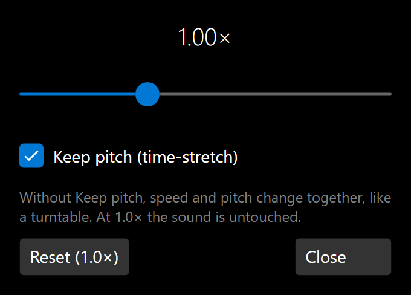

**A-B repeat.** Press **[** to set point A, again to set point B, and the part between them repeats; press it a third time to clear it. You can drag the A and B markers on the waveform.

**Sleep timer.** *Main menu › Sleep timer…* stops playback after 15 to 90 minutes or a number of minutes you enter, at the end of the current track or at the end of the playlist. By default the music fades out over 30 seconds first; AudioTastic can also close itself afterwards (*Settings › Playback*). **SLEEP** shows in the main window while the timer runs, and the tray icon's menu has the timer too.

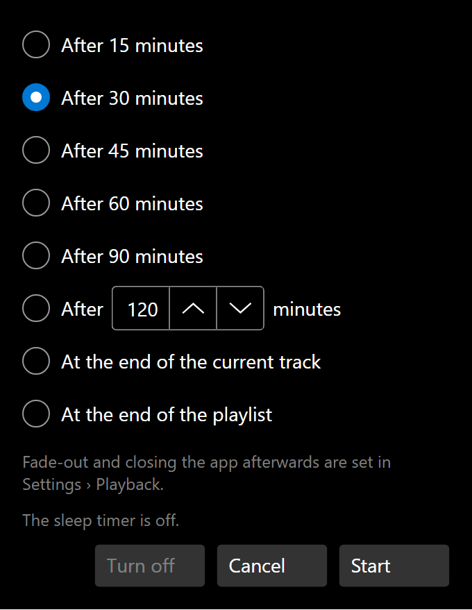

**Resume.** When you start AudioTastic, it reopens the track you were playing, paused at the same position (*Settings › Playback › Resume* can also start playing, or start fresh). Long files such as audiobooks and DJ mixes (20 minutes or longer by default) remember their position on their own, even when you play something else in between; `»` marks them in the playlist.

**Output.** *Settings › Output* chooses the sound device (right-click the volume slider for a quick choice) and how AudioTastic uses it:

- **Shared** mode plays alongside other programs. **Exclusive** (bit-perfect) mode takes over the device, so that at 100 % volume, with ReplayGain, speed changes and fades off, the samples reach your DAC unchanged. If the device refuses exclusive mode, AudioTastic uses shared mode.
- **High resolution:** files play at their own sample rate and bit depth (up to 32-bit and 384 kHz) where the device allows; otherwise they are resampled with high quality.
- **DSD** files (DSF, DFF) are converted to PCM, or sent as DoP to a DAC that supports it (exclusive mode).
- If the device disappears (unplugged, or a Remote Desktop session ends), AudioTastic switches to the default device. With no device left, it pauses and continues by itself when one is back.

## DJ-style crossfading

Crossfading starts the next track before the current one ends and mixes them together. Switch it on with the **XF** button and choose how in *Settings › Crossfading*. The main window shows **IO** or **BM** while it is on, and the waveform shades where the mix will happen.

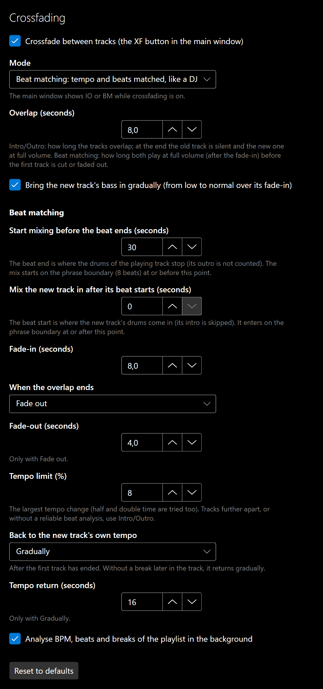

**Intro/Outro.** The playing track fades out while the next one fades in over it, for the *Overlap* you set. At the end, the old track is silent and the new one is at full volume.

**Beat matching** mixes like a DJ:

1. AudioTastic changes the next track's tempo to match the playing track, without changing its pitch, and lines up its beats with the playing track's beats.
2. The new track comes in where its drums start (its intro is skipped) and fades in over *Fade-in*, with its bass held back at first.
3. Both tracks play together at full volume for the *Overlap*. The mix starts on a phrase boundary (every 8 beats) before the playing track's drums end, by *Start mixing before the beat ends*.
4. Then the first track stops at once (*Cut*) or fades out (*Fade out*).
5. The new track goes back to its own tempo: at its next break, or gradually over *Tempo return*.

When two tracks' tempos are further apart than the *Tempo limit* (±8 % by default; half and double tempo are tried too), or a track has no reliable beat, that transition uses Intro/Outro instead.

AudioTastic analyzes each track's tempo (BPM), beats and breaks once, in the background, and remembers the result. The tempo appears in the track's *File info*. If a beat-matched mix sounds off for one track, right-click it in the playlist › **Adjust beat grid…** and move its beats a few milliseconds earlier or later.

## Equalizer and effects

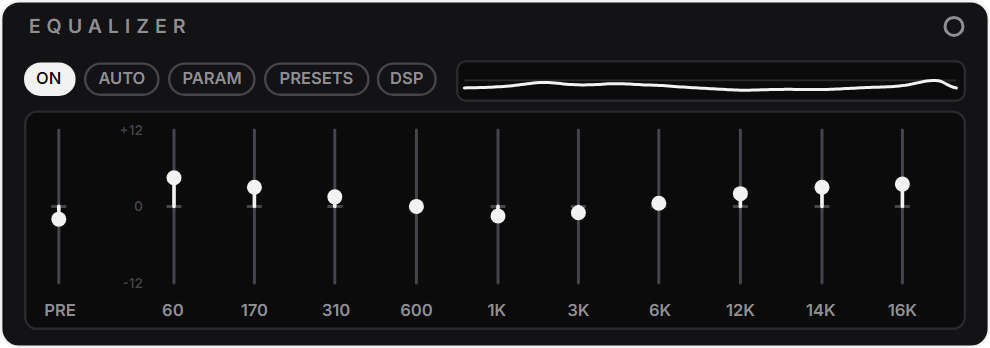

**The equalizer** has a preamp and ten bands from 60 Hz to 16 kHz. **ON** switches it on and off; the curve at the top right shows its effect. Drag a slider, use the mouse wheel on it, or select it with Tab and use the arrow keys (0.5 dB; Page Up and Page Down 3 dB; Home resets the band). You hear a change while you drag. AudioTastic lowers the overall level by itself when the curve would otherwise make loud music clip.

**PRESETS** loads built-in and your own presets, saves the current curve, deletes your presets, imports Winamp presets (`.eqf`, `.q1`) and resets to flat.

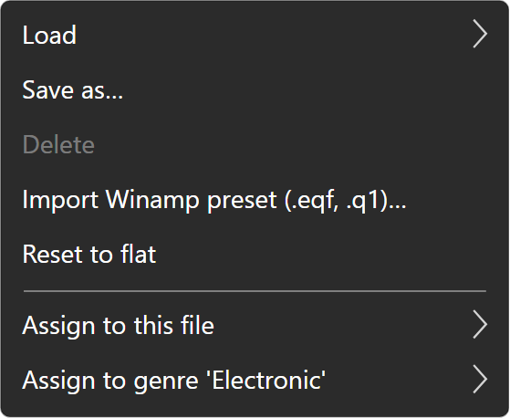

**AUTO** loads a preset automatically when a track starts: one you assigned to that file (*PRESETS › Assign to this file*), or else one assigned to the track's genre (*PRESETS › Assign to genre*, or *Settings › Equalizer & DSP › Genre rules*).

**PARAM** switches to the parametric equalizer: up to ten bands, each with its own type (peak, low and high shelf, low and high pass, notch), frequency, gain and Q. Drag a point to change its frequency and gain, use the mouse wheel on it for Q, double-click to add a band, and right-click for the band's type, to switch it off or delete it, and for **Bands…**, a table with exact values.

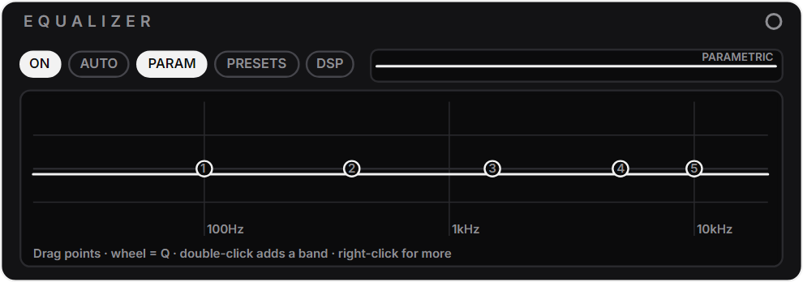

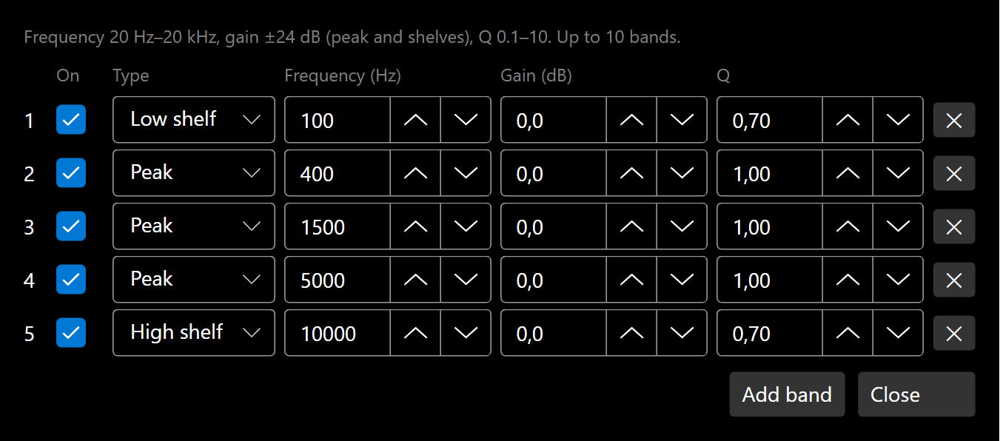

**DSP** opens the **effects chain**: the equalizer, a compressor, stereo widening, reverb and a limiter, plus VST3 effects and effects from plugins. Audio passes through them from top to bottom. Tick an effect to switch it on, select it to see its settings, and change the order with *Move up* and *Move down* (**Alt+Up**, **Alt+Down**).

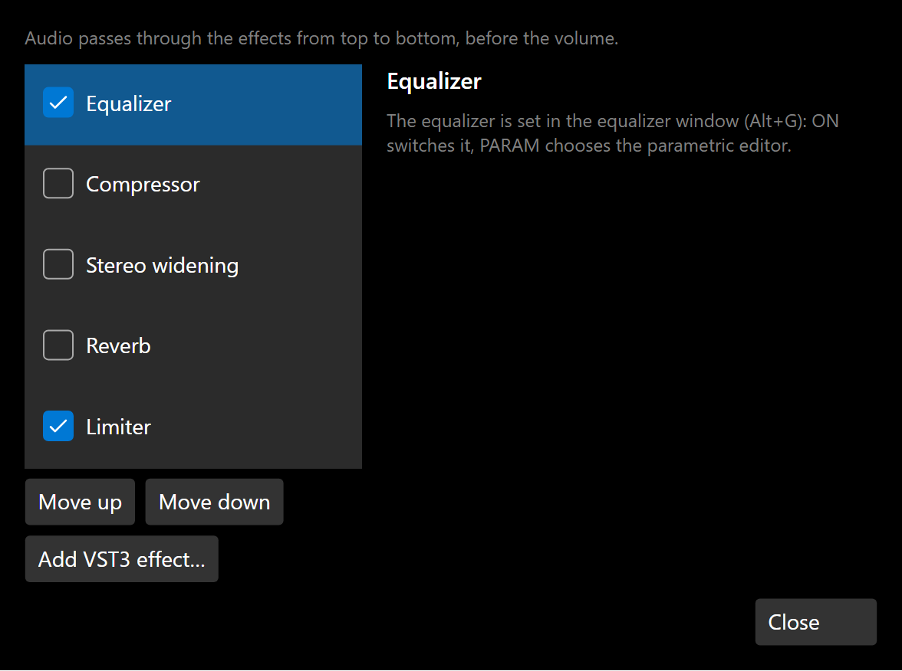

**VST3 effects.** *Add VST3 effect…* lists the VST3 audio effects installed on your computer, free or bought. AudioTastic looks in the standard VST3 folders and in any folders you add in *Settings › Equalizer & DSP*. Choose one and press *Add*; then select it in the chain and press *Open editor* for the effect's own window. Its settings are saved with the chain. A plug-in that crashes while AudioTastic scans it is set aside (blacklisted) instead of taking the player down; *Rescan all* tries it again.

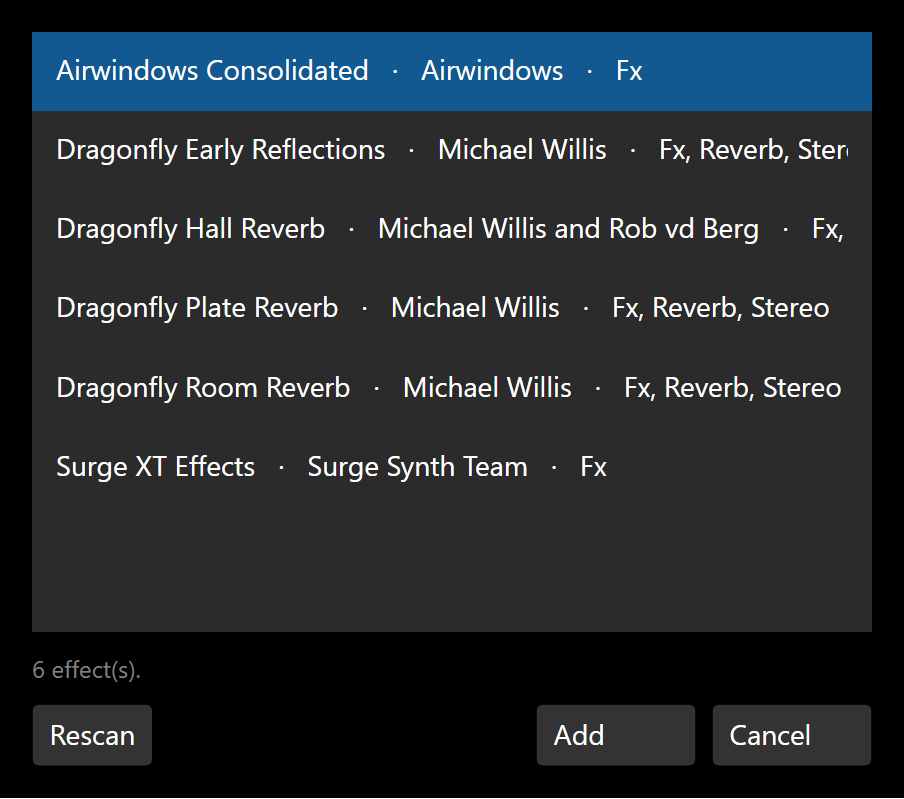

## Album art, lyrics and tags

### Art & Lyrics

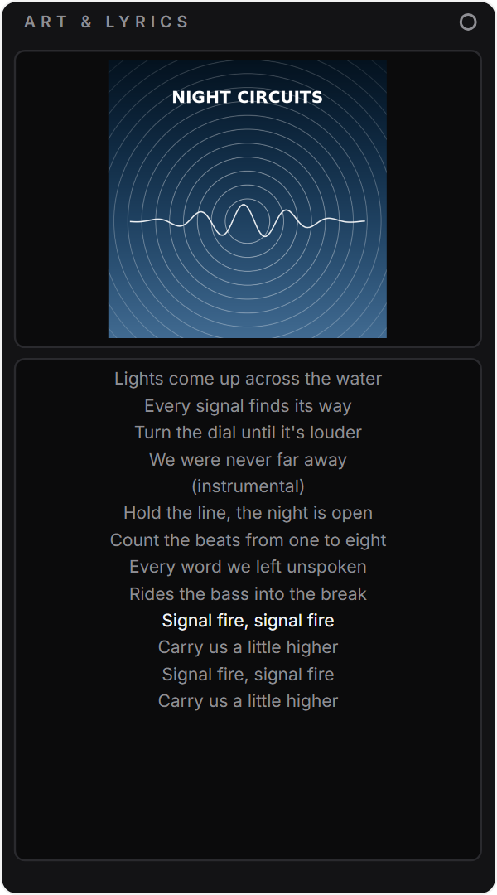

The **Art & Lyrics** window (**Alt+L**) shows the playing track's cover and its lyrics. The cover is the picture inside the file or, if there is none, a `cover`, `folder` or `front` picture (`.jpg` or `.png`) in the same folder. The lyrics come from an `.lrc` file with the same name as the track, or from the file's tags. Synced lyrics highlight the current line as the song plays; click a line to jump there. Resize the window from its corner; the lyrics get most of the room.

### Editing tags

Select one or more tracks and press **Ctrl+E**, or right-click › *Edit tags…*.

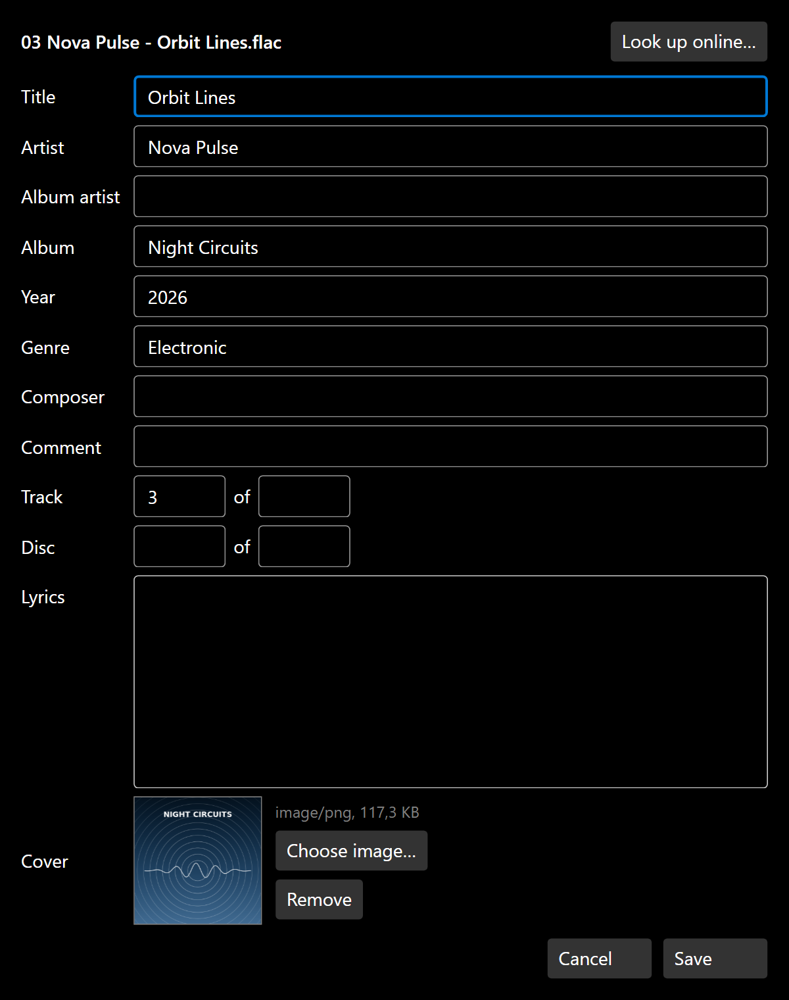

Edit the title, artist, album artist, album, year, genre, composer, comment, track and disc numbers, and the lyrics. *Choose image…* sets the cover and *Remove* takes it out. With several files selected, fields that differ show *multiple*; leave them as they are to keep each file's own value, or type to set them all. *Save* writes the tags; nothing changes in the music itself. A file that is playing is written as soon as the player lets go of it.

AudioTastic edits ID3v1 and ID3v2 tags (MP3, WAV, AIFF), Vorbis comments (FLAC, Ogg Vorbis, Opus), APEv2 tags (WavPack), MP4 tags (M4A with AAC or ALAC) and WMA tags.

### Looking up tags online

*Look up online…* (in the tag editor, or right-click a track) searches the internet for the track and shows each match next to your current tags, with a tick for each field to take. The cover comes along. Nothing is written until you press *Save* in the tag editor.

- AudioTastic asks **MusicBrainz** for tags and the **Cover Art Archive** for covers, at most once a second, as these services ask.
- With your own free **Discogs** token, Discogs is asked first, and MusicBrainz only when Discogs has nothing. Create the token at discogs.com › *Settings › Developers › Generate new token*, paste it in *Settings › Metadata* and tick *Discogs first*. The token stays on your computer and is left out of settings backups.
- A lookup only happens when you ask for one. It sends the title, artist and length.

### File info

**Alt+3**, double-clicking the badges in the main window, or right-click › *File info…* shows everything AudioTastic knows about a file: where it is, its format, codec, sample rate, bit depth, channels, length and bit rate, its loudness and ReplayGain values, its tempo, and all its tags. *Copy* puts it all on the clipboard.

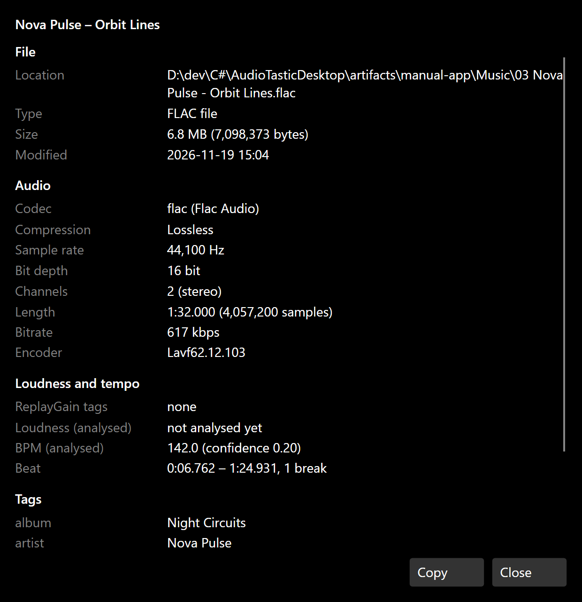

## Casting to TVs and speakers

The **CAST** button (or *Main menu › Cast to…*) lists *This computer* and the **Chromecasts** and **DLNA devices** (smart TVs, network receivers and speakers) on your network. It searches again each time it opens. AirPlay is not supported yet.

- **Cast the music:** choose a device (for a device with a screen, choose it › *Audio*). The playing track moves there at the same position. Play, pause, seek, previous, next and the volume slider control the device, and the playlist continues on it. Files the device cannot play are converted while they are sent (FLAC for a Chromecast, WAV for a DLNA TV). The title, artist, album and cover appear on a TV. *This computer* brings the music back.
- **Audio and video** (devices with a screen): the TV plays the player's own mix, with gapless playback, crossfades and the equalizer, together with the visualization. The player keeps the controls; the TV is about two seconds behind it. The volume slider sets the TV's volume.
- **Visuals only (music stays here)** (devices with a screen): the visualization appears on the TV while the music keeps playing on your computer. A TV shows the picture a little late, so AudioTastic draws it that far ahead and the picture matches your speakers. To fine-tune a TV, choose it › **Picture delay…**: while that window is open the TV flashes white on every kick drum; adjust the delay until the flashes land on the kicks. Internet radio cannot be read ahead, so with radio the picture trails.

Choose what the TV shows, its resolution (720p or 1080p) and frame rate in *Settings › Casting & network*. AudioTastic sends the music from a small built-in web server that answers only devices on your local network; Windows may ask you to allow it through the firewall. If your firewall needs a fixed port, set it there too.

## Converting files

Select tracks in the playlist, right-click › **Convert…**

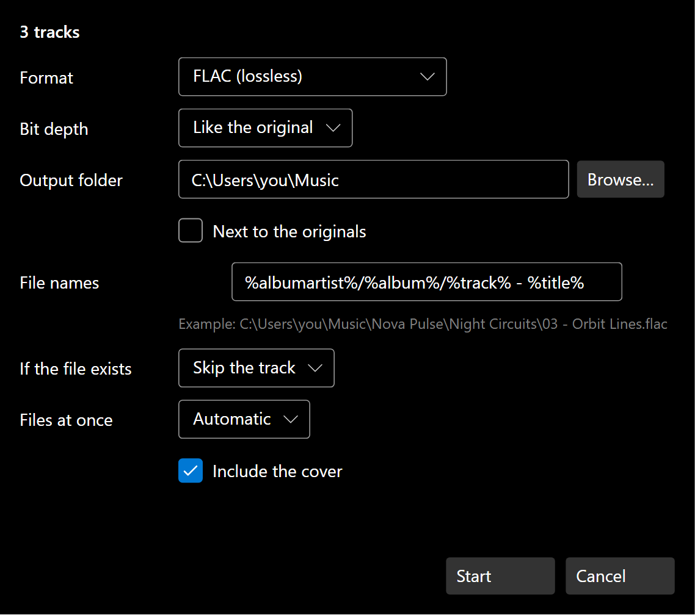

- **Format:** FLAC, Apple Lossless (ALAC), WAV, MP3 (constant or variable bit rate), AAC, Opus or Ogg Vorbis, with the quality or bit depth for each.
- **Where:** a folder (your Music folder at first) or *Next to the originals*.
- **File names:** a pattern such as `%albumartist%/%album%/%track% - %title%`. Fields: `%artist%`, `%albumartist%`, `%album%`, `%title%`, `%track%`, `%disc%`, `%year%`, `%genre%`, `%filename%`; a `/` makes a subfolder. The example below the pattern shows what the first file will be called.
- **If the file exists:** skip the track, replace the file, or add a number to the new name. The original file is never overwritten.
- **Files at once:** how many files are converted at the same time.

The tags and the cover come along. Tracks from a CUE sheet become separate files. *Start* shows the progress of each file; *Stop* removes files that were not finished.

## Windows integration

*Windows only.* Each of these can be switched off in *Settings › System integration* (notifications in *Settings › Interface*).

- **Media controls:** AudioTastic appears in the Windows media flyout and on the lock screen with the title, artist and cover. The keyboard's media keys and headset buttons control it, even while the player is hidden.
- **Global hotkeys** work while another program is in front: **Ctrl+Alt+Home** play/pause, **Ctrl+Alt+End** stop, **Ctrl+Alt+Page Up / Page Down** previous/next, **Ctrl+Alt+Up / Down** volume, and more. Change any of the twelve in *Settings › System integration*: click a field and press the new keys. A combination another program already uses is marked *In use by another program*.
- **Taskbar:** Previous, Play/Pause and Next buttons under the taskbar preview, and the playing position on the taskbar button (green while playing, yellow while paused).
- **Tray icon:** hover over it for the title; click it to hide or show the player; right-click for Play/Pause, Stop, Previous, Next, the sleep timer, Show/Hide and Exit. Optionally, minimizing or closing the player hides it in the tray.
- **Explorer:** right-click audio files or playlists › *Open in AudioTastic* (adds and plays them) or *Enqueue in AudioTastic* (adds them to the end of the playlist). On Windows 11 they are under *Show more options*.
- **File types:** *Choose default apps…* registers AudioTastic and opens Windows' *Default apps* page, where you make it the default player. Double-clicked files go to the running player and are played or only added, as you choose in *Settings › System integration*. Files that are played are added to the active playlist, or replace it if you choose *When opened files are played › Replace the playlist* (**Ctrl+Z** in the playlist brings the old list back).
- **Notifications:** a notification with the title, artist and cover when the track changes, skipped while AudioTastic is in front (off by default).

## Keyboard and screen readers

Every control in the player, playlist and equalizer can be reached with **Tab**; a thin outline shows where you are. **Enter** or **Space** presses the outlined button, and the arrow keys move sliders (volume, position, equalizer bands). Screen readers (Narrator on Windows) read each control's name, state, value and shortcut key, read playlist rows as "3. Artist – Title, 5:59", and announce each new track.

| Keys | Action |
|---|---|
| Z · X · C · V · B | Previous · Play · Pause · Stop · Next |
| Left · Right | Seek back · forward 5 seconds |
| Up · Down | Volume up · down |
| S · R | Shuffle · Repeat |
| L · Ctrl+L | Open files · Open URL |
| J | Search the playlist |
| Q · Shift+V | Play next (queue) · Stop after current |
| [ | A-B repeat (set A, set B, clear) |
| Alt+E · Alt+G · Alt+L | Playlist · Equalizer · Art & Lyrics windows |
| Ctrl+W · Ctrl+D | Mini player · Double size |
| Ctrl+E · Alt+3 | Edit tags · File info |
| Ctrl+P · Alt+F | Settings · Main menu |
| Ctrl+Shift+K | Visualization plugin window |
| In the playlist: Enter · Delete · Ctrl+A | Play · Remove · Select all |
| In the playlist: Alt+Up · Alt+Down | Move the selection |
| In the playlist: Ctrl+Z · Ctrl+Y | Undo · Redo |

## Command line

```
AudioTastic [files…] [--open | --enqueue]
            [--play] [--pause] [--playpause] [--stop] [--next] [--prev]
            [--volume 0-100] [--seek seconds] [--quit]
            [--portable] [--help] [--version]
```

- Files are added to the playlist and played (`--open`) or added to the end (`--enqueue`).
- The player commands go to the running player, or start it. `--stop`, `--pause` and `--quit` do nothing when no player is running.
- On Windows the commands can also be written `/next`, `/volume 40`.
- `--portable` keeps settings next to the program; `--help` and `--version` print to the console.

Examples: `AudioTastic --enqueue "D:\Music\Song.flac"`, `AudioTastic --volume 40`, `AudioTastic --seek 90`.

## Skins and plugins

**Skins** change the look of every player window. *Main menu › Skins* switches between installed skins while the music plays; *Install skin…* installs an `.atskin` file. Skin authors find the format in [docs/skins/skin-format.md](../skins/skin-format.md).

**Plugins** add formats, effects, visualizations, output devices and panels. *Settings › Plugins* installs `.atplugin` files, switches plugins on and off, removes them and opens their settings. A plugin that keeps failing is switched off for the session instead of stopping the player. The built-in plugins are listed there too:

- **FFmpeg decoder:** almost every audio format and internet radio.
- **MIDI synthesizer:** plays `.mid` files through a SoundFont. Its *Settings…* downloads the free GeneralUser GS SoundFont, or lets you choose any `.sf2` file.
- **Tracker modules:** MOD, XM, IT and S3M.
- **OptimFROG** (optional download from the Releases page): `.ofr` files, on Windows x64, Linux x64 and Intel Macs.

Plugin authors: see the [plugin guide](../plugins/plugin-guide.md).

## Settings

*Settings* (**Ctrl+P**, or *Main menu › Settings…*) has ten pages. Changes apply at once and are kept when you restart. *Reset to defaults* at the bottom of a page resets that page only.

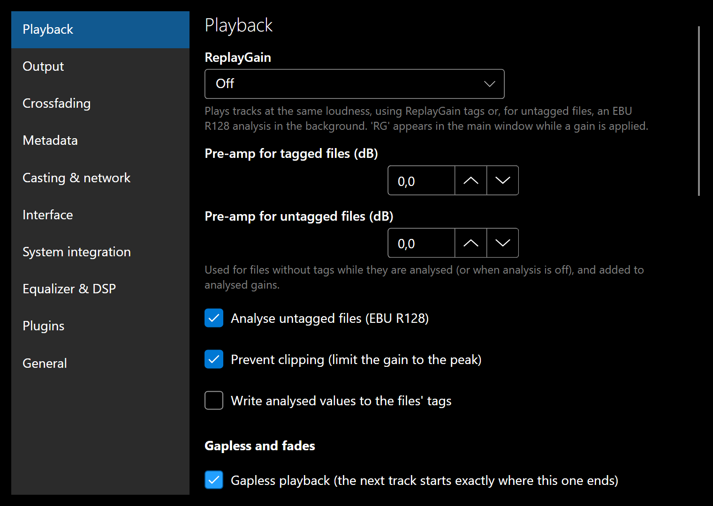

### Playback

ReplayGain and its pre-amps, gapless playback, the fades on pause, stop and seek, speed per file, resume on start and for long files, the play-next queue and the sleep timer's fade-out and closing.

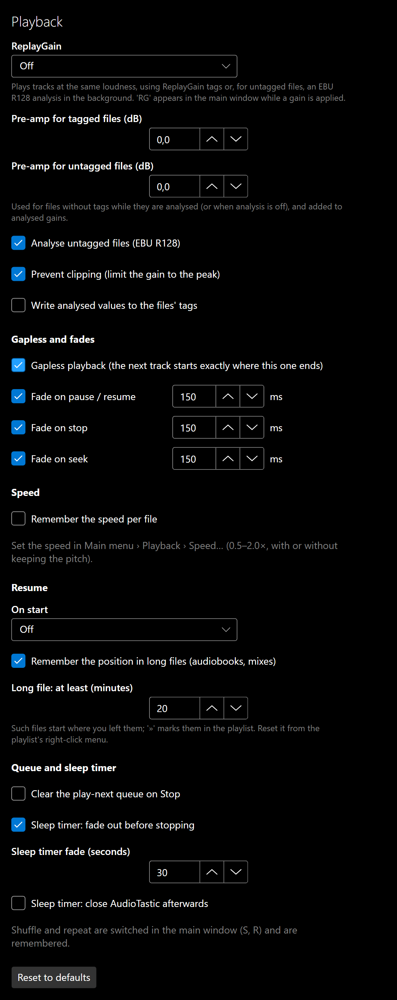

### Output

The sound device, shared or exclusive mode, the bit depth in exclusive mode, matching the device's rate to each file, resampling, dither, DSD as PCM or DoP, and the buffer size.

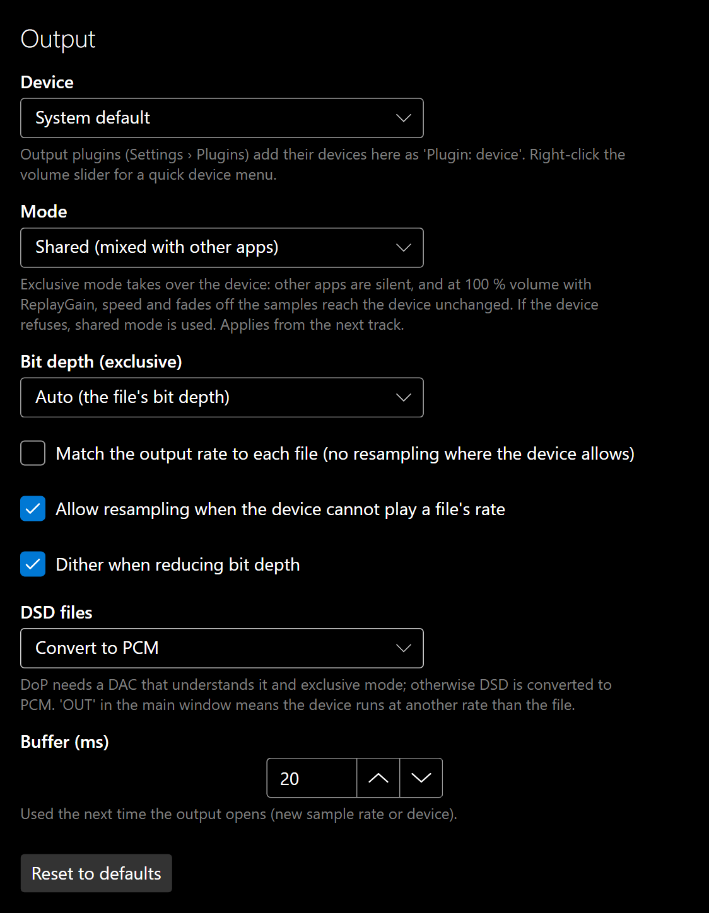

### Crossfading

See [DJ-style crossfading](#dj-style-crossfading) for what each setting does.

### Metadata

Album art, lyrics, and online lookup with MusicBrainz, the Cover Art Archive and Discogs (with your token).

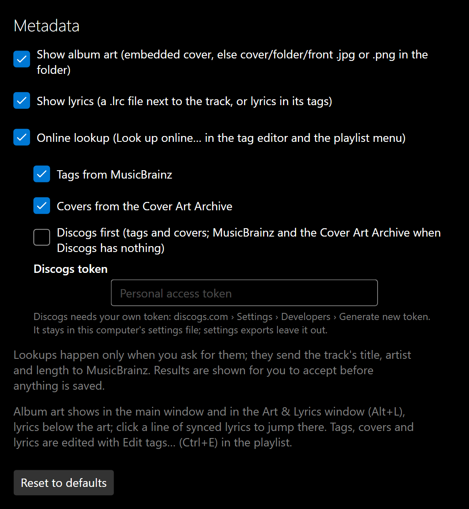

### Casting & network

The streaming server's port, and what a TV shows: the visualization, resolution and frame rate, and *Picture delay…* for the TV that shows the visuals.

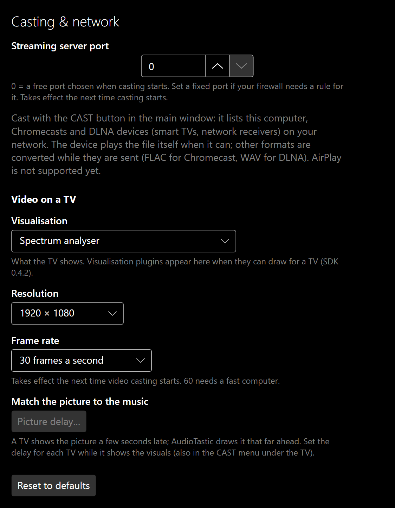

### Interface

The skin, player size, double size, always on top (main window and mini player), the scrolling title and its speed, track-change notifications, the dialogs' theme (follow the system, dark or light), and the visualization: type, number of spectrum bars, how fast the peaks fall, and frame rate.

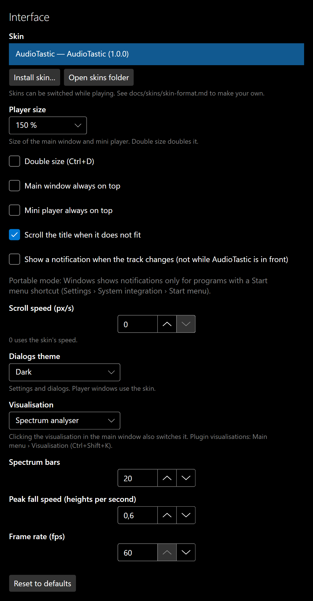

### System integration

What happens to files opened from the file manager or command line (play or only add, and whether played files are added to the playlist or replace it), the Explorer context menu, file types, the Start menu shortcut, media controls, global hotkeys, taskbar progress and the tray icon (*Windows only*).

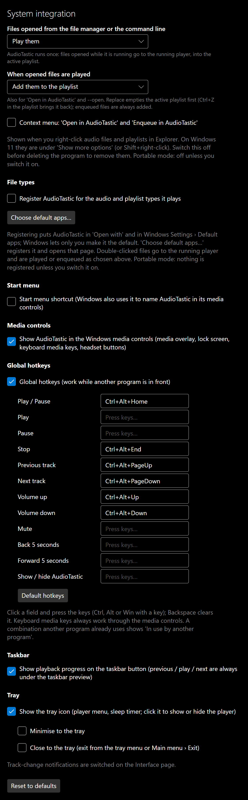

### Equalizer & DSP

Shortcuts to the equalizer and the effects chain, the VST3 folders (*Add folder…*, *Rescan all*, blacklisted plug-ins), and Auto EQ with its genre rules.

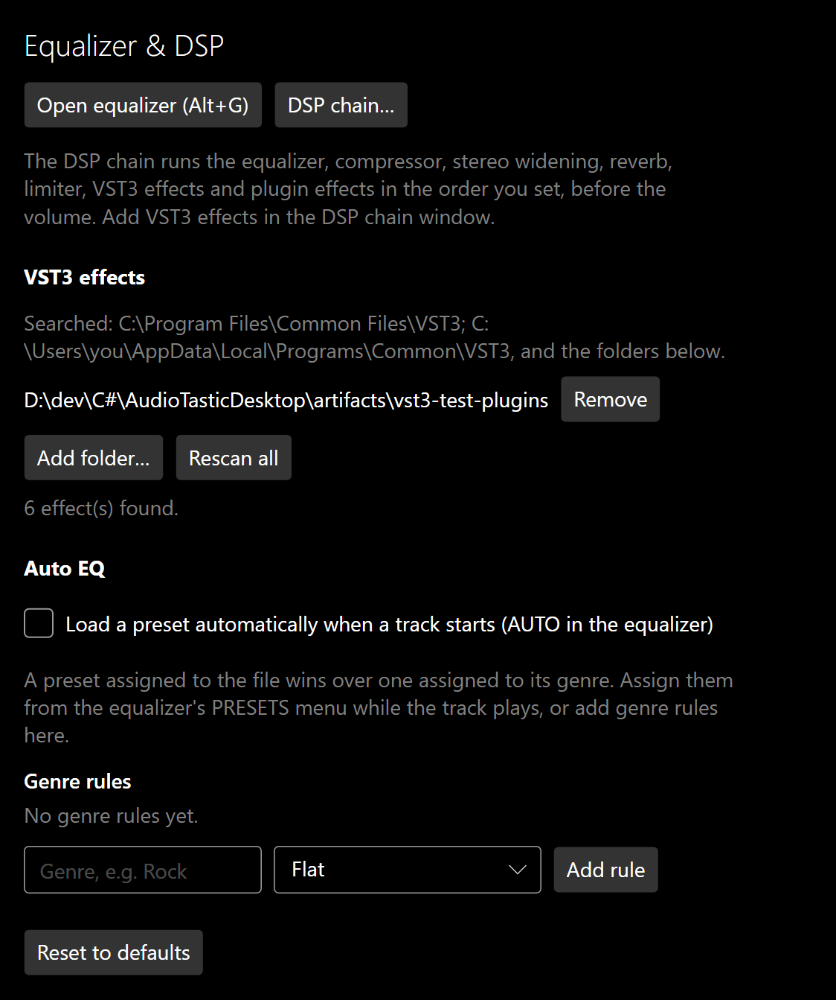

### Plugins

Install, switch off, remove and configure plugins.

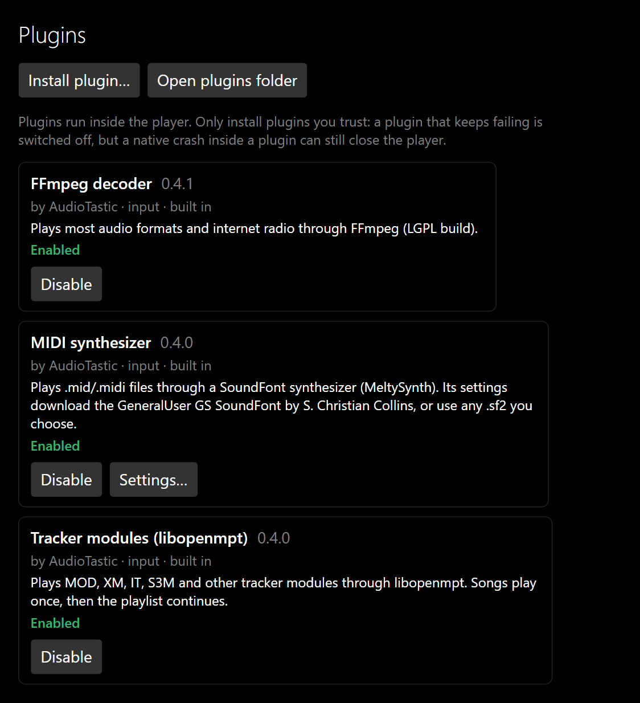

### General

The log level, how many threads analyze tracks in the background, the data folder, and the settings backup.

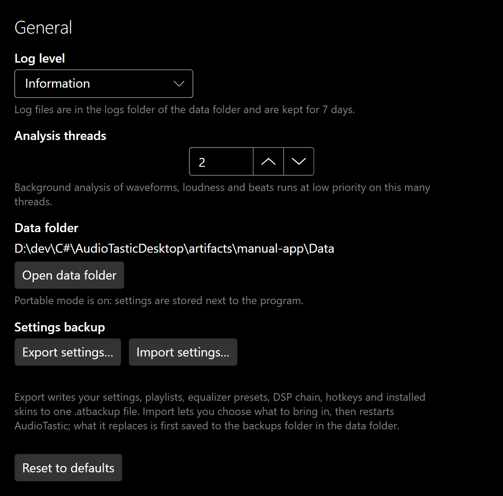

## Backup and your data

**Settings backup.** *Settings › General › Export settings…* writes your settings, playlists, equalizer presets, effects chain (with VST3 effects), hotkeys and installed skins to one `.atbackup` file. *Import settings…* shows what a backup holds and lets you choose what to bring in. AudioTastic then restarts to apply it, after saving what it replaces to the `backups` folder in the data folder. Backups from older versions are upgraded. Caches (waveforms, analysis) are not included; they are rebuilt. Your Discogs token is never put in a backup.

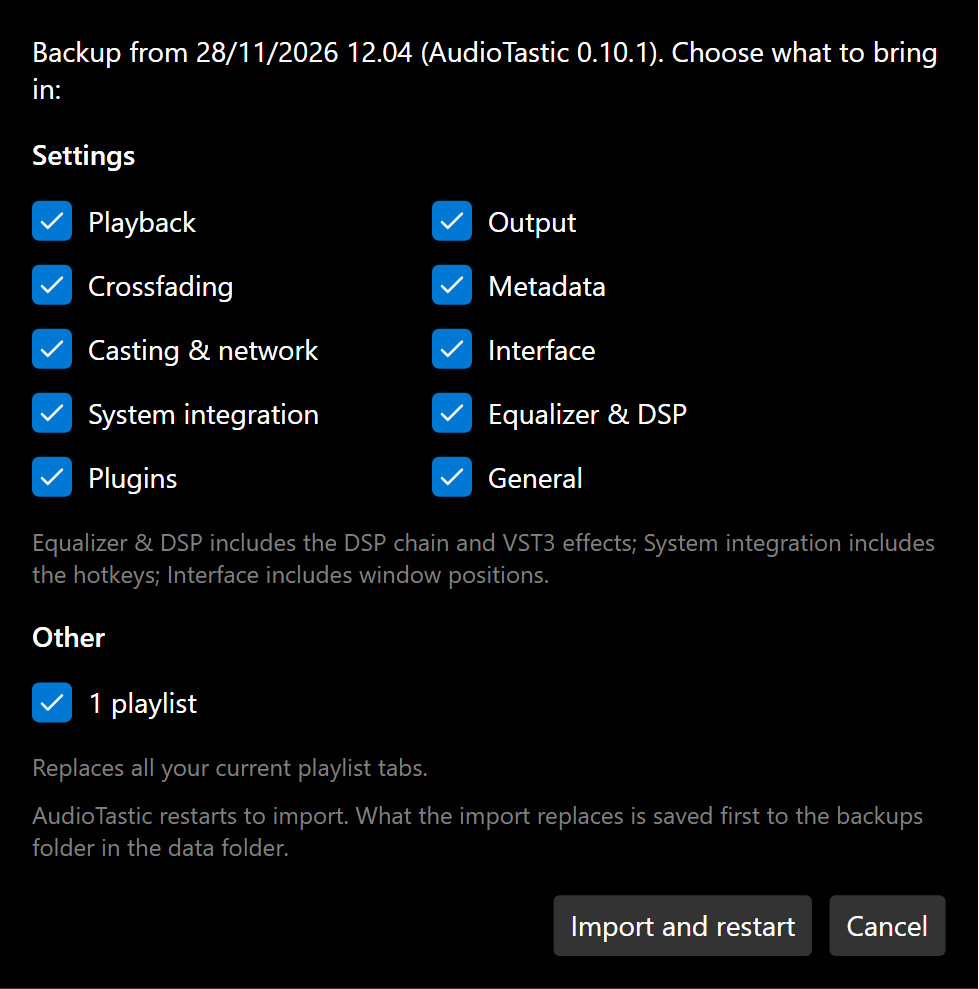

**Where your data is.** Settings, playlists, presets, skins, plugins, the analysis cache, logs and crash reports are kept in:

| System | Folder |
|---|---|
| Windows | `%APPDATA%\AudioTastic` |
| macOS | `~/Library/Application Support/AudioTastic` |
| Linux | `~/.config/AudioTastic` |
| Portable mode | `Data` next to the program |

*Settings › General › Open data folder* takes you there. **Portable mode** is on when a file named `portable` sits next to the program (as in the portable zip) or when you start it with `--portable`.

**Privacy.** AudioTastic sends nothing anywhere on its own. Online lookups happen only when you ask for one, and send the title, artist and length to MusicBrainz or, with your token, Discogs. Casting talks only to devices on your local network. Logs and crash reports stay on your computer.

## Troubleshooting

- **No sound:** check the device in *Settings › Output*, or right-click the volume slider. In exclusive mode, another program may hold the device; try shared mode.
- **A file does not play:** *File info* (**Alt+3**) shows what AudioTastic could read from it. Damaged files are skipped with a message, and the playlist continues. DRM-protected WMA files cannot be played.
- **The sound device disappeared:** AudioTastic switches to the default device, or pauses when no device is left and continues by itself when one is back.
- **A cast device is missing:** the computer and the device must be on the same network, and the firewall must allow AudioTastic. Open the CAST menu again to search again.
- **A beat-matched mix sounds off:** *Adjust beat grid…* on the track, or use Intro/Outro for that kind of music.
- **The Explorer entries stay after deleting a portable copy:** switch them off in *Settings › System integration* before deleting the program, or run `AudioTastic --unregister`.
- **Logs:** the `logs` folder in the data folder, kept for 7 days. *Settings › General › Log level* makes them more detailed.
- **Crashes:** AudioTastic writes a crash report to the `crash` folder in the data folder and offers to show it the next time it starts. Nothing is uploaded; you can attach it to an issue on [GitHub](https://github.com/castenskiold/AudioTasticDesktop/issues).

## Supported formats

| Kind | Formats |
|---|---|
| Lossless | FLAC, WAV, AIFF, Apple Lossless (ALAC), APE (Monkey's Audio), WavPack, TTA, Shorten, OptimFROG (with its plugin) |
| Lossy | MP3, AAC / M4A, Ogg Vorbis, Opus, WMA, Musepack |
| High resolution | DSD (DSF, DFF) as PCM or DoP; PCM up to 32-bit / 384 kHz |
| Synthesized | MIDI (with a SoundFont), tracker modules (MOD, XM, IT, S3M) |
| Streams | Internet radio over HTTP and HTTPS (Icecast, SHOUTcast), `.m3u` and `.pls` links |
| Playlists | M3U, M3U8, PLS, XSPF, WPL (read and write), CUE sheets (read, also inside FLAC and APE tags) |
| Conversion to | FLAC, ALAC, WAV, MP3, AAC, Opus, Ogg Vorbis |
